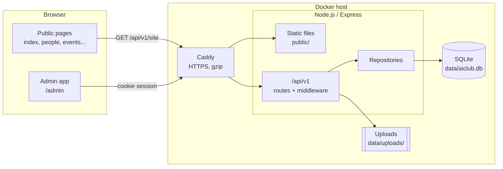

# Architecture

## Overview

One Node.js service serves both the website and a versioned JSON API. Content lives in SQLite and images on disk, all under one data directory. This is deliberately simple. A student club site sees modest traffic and gets handed to new maintainers every year, so the whole system is one container plus one volume to back up. There are no external databases, queues or build pipelines to keep alive.



## Request flow

1. **Public pages** are static HTML. `core.js` makes one request, `GET /api/v1/site`, which returns settings and every collection in one payload. Responses carry an ETag, so repeat visits get a cheap `304`. If the API can't be reached (static hosting, or the server is down), the page loads `assets/js/data.js` instead and still renders fully.
2. **The admin app** (`/admin`) signs in with `POST /api/v1/auth/login`. The server sets an `HttpOnly`, `SameSite=Lax` cookie holding a signed JWT. Every later request goes through `authenticate`, then `requireRole`, then zod validation, then a repository.
3. **Writes** are recorded in `audit_log`, so club generations can see who changed what.

## Code layout

```
server/src/
  index.js            boot: open DB, migrate, seed, listen, graceful shutdown
  app.js              createApp(repos): security headers, API router, static hosting
  config.js           all environment variables, validated in one place
  db/
    index.js          connection (WAL mode) and the migration runner
    migrations/*.sql  schema, applied in order and tracked in schema_migrations
    seed.js           first-boot content (from public/assets/js/data.js) and the admin account
  lib/
    schemas.js        content model: one registry drives validation, DB mapping and routes
    importer.js       validated full-site import and export (backups)
  middleware/         auth, CSRF origin check, CORS, rate limits, validation, errors
  repositories/       all SQL lives here; routes never touch the DB directly
  routes/             thin HTTP handlers grouped by resource
  cli/create-admin.js recovery: create or reset an admin from the shell
public/               the website (plain HTML, CSS and JS, no build step)
```

**Adding a content type** (for example "alumni") takes three steps: a migration that creates the table, an entry in `lib/schemas.js`, and an entry in `SCHEMAS` in `public/assets/js/pages/admin.js`. The CRUD routes, validation, export and import pick it up automatically.

## Security model

| Concern | Measure |
|---|---|
| Passwords | bcrypt with cost 12. A minimum of 10 characters. Unknown emails take the same time to reject as wrong passwords. |
| Sessions | Signed JWT in an `HttpOnly` cookie that is also `Secure` in production. Each user has a `token_version`, and changing a password or role increments it, which signs that user out of every other session. |
| CSRF | `SameSite=Lax` cookies, plus a check that rejects state-changing requests whose `Origin` is not this site or listed in `CORS_ORIGINS`. |
| Authorisation | Two roles. `editor` manages content, messages and media. `admin` can also manage users, view the audit log and import backups. The last admin can't be demoted or deleted. |
| Input | Every write is validated by a strict zod schema, so unknown fields are rejected. Links can't use `javascript:`, `data:` or similar script-capable schemes. |
| XSS | All rendering escapes output. The CSP is `script-src 'self'`, with no inline scripts. |
| Uploads | The file type is identified from its signature bytes, not the extension. Files get random names and a size limit. Uploads are served with a `sandbox` CSP and `nosniff`, so a malicious SVG can't run scripts. |
| Abuse | Rate limits on login (10 per 15 minutes), the contact form (5 per hour) and the API overall. The contact form has a hidden honeypot field. |
| Headers | Helmet sets HSTS, frame-ancestors, referrer-policy and more. `x-powered-by` is turned off. |

## Data and backups

Everything that matters is in `DATA_DIR`: `aiclub.db` plus `uploads/`. You can back it up in two ways:

- `deploy/backup.sh` takes a consistent SQLite snapshot and a tarball of the uploads. Run it nightly from cron.
- **Admin → Backup & restore** downloads all content as JSON. Restoring validates the whole file before it changes anything.

## Scaling notes

SQLite in WAL mode handles thousands of reads per second on a small VM, far more than this site needs. If the club ever needs several app instances, swap the repository layer for Postgres. The route and validation layers don't need to change, because they only talk to repositories.
